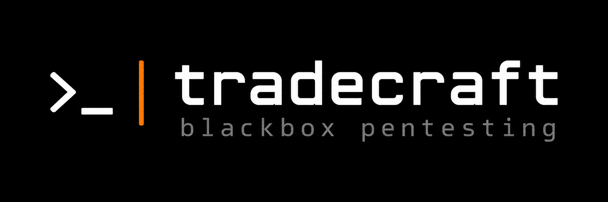

An LLM-driven security-testing agent: a single continuous tool-calling
loop, not a staged recon→exploit pipeline. The model decides what to
run next, turn by turn, against a real target.

> **Disclaimer:** the tools in Tradecraft can cause permanent damage if
> not configured properly. Use it only against targets you own or have
> explicit permission to test. Don't rely on the defaults — understand
> the configuration (`docs/tools.md`, `docs/policy.md`,
> `docs/profiles.md`) before your first engagement.

**Tools** are the actions the model can call — each one a YAML contract
(what it does, what inputs it needs) plus an adapter that executes a
real command and parses its output into structured data. See
[`docs/tools.md`](docs/tools.md) for how a tool is built, or the full
list of what's registered — 160+ tools across recon, web, cloud, AD,
Kubernetes, and post-exploitation — in [`docs/tool-list.md`](docs/tool-list.md).

**Skills** are advisory markdown notes giving the model cross-tool
tradecraft knowledge — when to prefer one tool over another, how two
tools' outputs chain together. They're never an enforced phase, and
they're always rendered in full. See [`docs/skills.md`](docs/skills.md).

Every engagement run is persisted to disk and can be turned into a
report (`--report`), explored afterward in a Q&A console (`tradecraft
chat`), or exported as SFT/DPO fine-tuning data (`tradecraft dataset`).
See [`docs/report.md`](docs/report.md), [`docs/post-engagement.md`](docs/post-engagement.md),
and [`docs/finetune.md`](docs/finetune.md).

## Layout

```
config/tools/<id>.yaml   model-facing contract (description, params, scope_param)
config/profiles/         curated tool sets per engagement shape (web, cloud, ad-network, ...)
tradecraft/domain.py        pure shared types
tradecraft/adapters/<tool>/ execute.py (subprocess) + parse.py (pure parsing)
tradecraft/tools/           glues a YAML contract + adapter into one Tool.run()
tradecraft/memory/          append-only engagement log, facts, and evidence store
tradecraft/policy/          destructive-tool gate
tradecraft/skills/          advisory tradecraft markdown, rendered in full
tradecraft/execution/       the agentic loop + system-prompt assembly
tradecraft/reporting/       report generation + post-run investigation console
tradecraft/dataset/         offline SFT/DPO dataset extraction from persisted runs
tradecraft/cli.py           entrypoint
```

Dependency direction is one-way: domain → adapters → tools → execution
→ cli.

## Setup

```bash
python -m venv .venv && source .venv/bin/activate
pip install -e ".[test]"
cp .env.example .env   # configure LLM_MODEL, LLM_BASE_URL, and LLM_API_KEY
```

Use an abliterated (safety-refusal-removed) model for `LLM_MODEL` — a
standard safety-tuned model will refuse large parts of what this agent
needs to do mid-engagement.

Each tool's required binary (see its `config/tools/<id>.yaml`) must be
on `PATH`; a missing binary is returned to the model as a tool error,
not a crash. `scripts/verify_container_tools.py` checks which of the
registered tools' binaries are present. For a known-good full toolset
without installing everything yourself, see
[`docs/setup.md`](docs/setup.md) for building and running the Docker
image instead.

## Usage

```bash
tradecraft 10.0.0.5 --profile web
```

`--profile` picks a curated tool set for the engagement shape (`web`,
`ad-network`, `cloud`, `kubernetes`, `post-exploitation`, or `full` for
every registered tool); `--tools` overrides it with an explicit list.
Destructive tools are off by default — pass `--allow-destructive` to
enable them. Run `tradecraft --help` for the full flag list, or see
[`docs/cli.md`](docs/cli.md) for every subcommand (`chat`, `report`,
`dataset`, `memory`) at a glance.

Network routing/egress (VPN, SOCKS/TUN gateway, or container `network_mode`) is
handled at the environment layer rather than inside adapters; if setting
`HTTP_PROXY`/`HTTPS_PROXY`, add the `LLM_BASE_URL` host to `NO_PROXY`.

## Testing

```bash
pytest
```

## Docs & Issues

- Found a bug, want a feature, or have a tool/adapter to propose? [Open an issue](../../issues/new/choose) — there's a template for each.
- [`docs/cli.md`](docs/cli.md) — every `tradecraft` subcommand and flag at a glance.
- [`docs/setup.md`](docs/setup.md) — building/running the Docker image, getting logs, extracting run data.
- [`docs/tools.md`](docs/tools.md) — tools, adapters.
- [`docs/tool-list.md`](docs/tool-list.md) — every registered tool, at a glance.
- [`docs/policy.md`](docs/policy.md) — destructive-tool gating, blast-radius categories, the account-lockout budget.
- [`docs/skills.md`](docs/skills.md) — what a skill is, how/when to add one.
- [`docs/profiles.md`](docs/profiles.md) — engagement-shape profiles, overlap, how to add one.
- [`docs/report.md`](docs/report.md) — generating a report from a run.
- [`docs/post-engagement.md`](docs/post-engagement.md) — the post-run Q&A console.
- [`docs/finetune.md`](docs/finetune.md) — turning engagement runs into SFT/DPO fine-tuning data.
- [`CONTRIBUTING.md`](CONTRIBUTING.md) — how to add a new tool.
