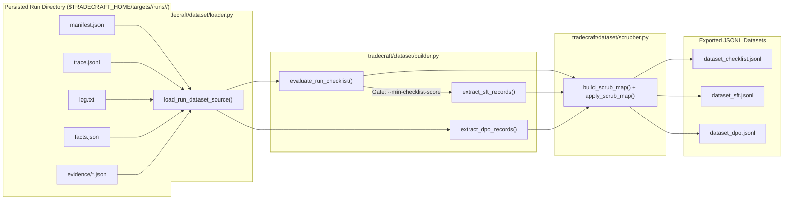

# Fine-tuning data (`docs/finetune.md`)

This document explains how Tradecraft transforms persisted engagement runs into high-quality Supervised Fine-Tuning (SFT) and Direct Preference Optimization (DPO) datasets via the standalone `tradecraft/dataset/` module, and how to curate training data that improves model reasoning without causing mode collapse or tool-availability bias.

---

## 1. Architectural Independence & Pipeline Flow

Tradecraft separates live scanning, reporting, and dataset extraction into three independent modules:

1. **Scanning Loop (`tradecraft/execution/`):** Runs the continuous tool-calling loop and persists raw engagement artifacts under `$TRADECRAFT_HOME/targets/<target>/runs/<run_id>/`. It never imports `tradecraft/dataset/`.
2. **Reporting (`tradecraft/reporting/`):** Synthesizes human and SIEM deliverables (`md`, `html`, `json`, `sarif`) from a run directory.
3. **Dataset & Knowledge Extraction (`tradecraft/dataset/`):** A strictly offline, deterministic pipeline (`tradecraft dataset` or `python -m tradecraft.dataset`) that reads persisted run directories on disk and emits training-ready JSONL files with zero LLM calls or external security binaries required.



### Why Tradecraft Traces Are Self-Contained Per Turn

On every turn, `tradecraft/execution/loop.py` constructs the prompt as:

```text
[system_prompt, *trimmed_conversation, state_message]
```

where `state_message` renders the current `## Known Facts`, `## Engagement Log`, and turn/trimming budget at the tail of the prompt. Each `CallRecord` in `trace.jsonl` records:
- `request.messages` and `request.tools` (exact prompt and active tool schemas seen by the model)
- `reasoning_content`, `content`, and full `tool_calls` (`id`, `type`, `function.name`, `function.arguments`)
- `finish_reason`, `truncation_attempt`, `network_attempt`, and `usage`

Because the full state is carried in the trailing `state_message`, **every line in `trace.jsonl` is a complete, self-contained single-turn decision snapshot** — even on long engagements where earlier conversation turns were trimmed.

---

## 2. Output Formats (`sft`, `dpo`, `checklist`)

### A. Per-Turn SFT (`dataset_sft.jsonl`)

Each SFT record captures one high-quality assistant turn conditioned on the exact `messages` and `tools` active at that moment:

```json
{
  "id": "20261107T010000Z_ds01:turn_5:turn",
  "run_id": "20261107T010000Z_ds01",
  "target": "target.example",
  "turn": 5,
  "call_kind": "turn",
  "messages": [
    {"role": "system", "content": "..."},
    {"role": "user", "content": "Begin the engagement against: target.example"},
    {"role": "user", "content": "## Known Facts\nsub1.target.example:443 arjun_params_discovered=['id']\n..."},
    {
      "role": "assistant",
      "content": "",
      "reasoning_content": "Hydrating GraphQL evidence and testing discovered parameter 'id' on sub1.target.example.",
      "tool_calls": [
        {
          "id": "call_read_ev_5",
          "type": "function",
          "function": {
            "name": "read_evidence",
            "arguments": "{\"target\": \"sub1.target.example\", \"tool\": \"graphql_introspect\"}"
          }
        },
        {
          "id": "call_sqli_5",
          "type": "function",
          "function": {
            "name": "sqlmap_scan",
            "arguments": "{\"target\": \"https://sub1.target.example/item?id=1\"}"
          }
        }
      ]
    }
  ],
  "tools": [...],
  "metadata": {
    "model": "openai/qwen3.8-27b",
    "profile": "web",
    "guidance": null,
    "allow_destructive": false,
    "finish_reason": "tool_calls",
    "tool_call_names": ["read_evidence", "sqlmap_scan"],
    "behaviors": ["evidence_hydration", "parallel_batching", "pivot_on_lead"],
    "score": 6,
    "fact_delta": 1,
    "is_redundant": false,
    "prompt_tokens": 880,
    "completion_tokens": 90
  }
}
```

### B. Natural DPO / Preference Pairs (`dataset_dpo.jsonl`)

Instead of relying on synthetic corruption, `extract_dpo_records` harvests **four organic contrast signals** where the engagement itself proved one action inferior to another on the same state:

| Contrast `reason` | `rejected` Completion | `chosen` Completion | What It Teaches |
| :--- | :--- | :--- | :--- |
| **`truncation_retry`** | Attempt that exhausted `max_tokens` (`finish_reason == "length"`) with runaway reasoning or truncated tool JSON | Subsequent clean retry on the same turn | Concise reasoning and well-formed tool-call JSON within token budgets |
| **`open_thread_nudge`** | Premature final-report stop (`finish_reason == "stop"`) while discovered parameters or `interactsh` payloads remained untested | Post-nudge assistant turn that executed the follow-up verification tool call | Completing open investigation threads before wrapping up |
| **`retracted_finding` / `unverified_finding`** | Assistant turn calling `log_finding` without an `evidence_id` or for a claim later retracted via `retract_finding` | Same turn with the premature `log_finding(finding=X)` rewritten to `log_note(note=X)` | Recording unverified hypotheses as notes rather than false-positive findings |
| **`redundant_tool_call`** | Assistant turn repeating an identical `(tool_name, arguments)` call already executed earlier in the run | Next clean, non-redundant tool-calling turn in the engagement | Pivoting to new leads instead of looping on the same tool and target |

#### Concrete DPO Record Examples

**1. `retracted_finding` / `unverified_finding` (`log_finding` $\rightarrow$ `log_note` rewrite):**

```json
{
  "id": "20261107T010000Z_ds01:turn_2:retracted_finding",
  "run_id": "20261107T010000Z_ds01",
  "target": "target.example",
  "turn": 2,
  "reason": "retracted_finding",
  "prompt": [
    {"role": "system", "content": "..."},
    {"role": "user", "content": "Begin the engagement against: target.example"},
    {"role": "user", "content": "## Known Facts\nsub1.target.example:443 status=200"}
  ],
  "tools": [...],
  "chosen": {
    "role": "assistant",
    "content": "",
    "reasoning_content": "I suspect SQLi on login.",
    "tool_calls": [
      {
        "id": "call_bad_find",
        "type": "function",
        "function": {
          "name": "log_note",
          "arguments": "{\"note\": \"Unverified SQLi on sub1.target.example login\"}"
        }
      }
    ]
  },
  "rejected": {
    "role": "assistant",
    "content": "",
    "reasoning_content": "I suspect SQLi on login.",
    "tool_calls": [
      {
        "id": "call_bad_find",
        "type": "function",
        "function": {
          "name": "log_finding",
          "arguments": "{\"finding\": \"Unverified SQLi on sub1.target.example login\"}"
        }
      }
    ]
  }
}
```

**2. `open_thread_nudge` (Premature Stop vs. Follow-Up Verification Tool Call):**

```json
{
  "id": "20261107T010000Z_ds01:turn_4:open_thread_nudge",
  "run_id": "20261107T010000Z_ds01",
  "target": "target.example",
  "turn": 4,
  "reason": "open_thread_nudge",
  "prompt": [
    {"role": "system", "content": "..."},
    {"role": "user", "content": "## Known Facts\nsub1.target.example:443 arjun_params_discovered=['id']"}
  ],
  "tools": [...],
  "chosen": {
    "role": "assistant",
    "content": "",
    "reasoning_content": "Hydrating GraphQL evidence and testing discovered parameter 'id' on sub1.target.example.",
    "tool_calls": [
      {
        "id": "call_sqli_5",
        "type": "function",
        "function": {
          "name": "sqlmap_scan",
          "arguments": "{\"target\": \"https://sub1.target.example/item?id=1\"}"
        }
      }
    ]
  },
  "rejected": {
    "role": "assistant",
    "content": "# Executive Summary\nWrapping up early.",
    "reasoning_content": "I think I am done."
  }
}
```

### C. Programmatic Run Checklist & 8-Dimension Rubric (`dataset_checklist.jsonl`)

`evaluate_run_checklist` evaluates each run directory across 15 tool-conditioned checks (`check_statuses`: `"PASS"`, `"FAIL"`, or `"N/A"` when the required tool or target surface was absent), 8 quantitative rubric dimensions (`scores`, `0.0–10.0` each + `overall_score`), and automated root-cause `diagnostics`:

1. **`clean_completion`:** Run finished with a deliberate final report stop (`finish_reason == "stop"`), not an unhandled network/truncation abort.
2. **`tool_provenance_recorded`:** `manifest.json` records `profile` or `tool_ids`.
3. **`recon_breadth`:** Conditioned on breadth tools in `available_tools`; verifies discovery/breadth tools were executed.
4. **`host_probing_coverage`:** Conditioned on `discovered_hosts_count >= 2`; verifies $\ge 80\%$ of discovered hosts were probed.
5. **`param_injection_followup`:** Conditioned on discovered parameters in `facts.json` and injection tools in `available_tools`; verifies $100\%$ of parameterized `(host, port)` records were tested.
6. **`interactsh_polled`:** Conditioned on `interactsh(action="generate")`; verifies `poll` was called afterward.
7. **`evidence_discipline`:** Zero retracted findings (`[RETRACTED]`) and zero unverified findings (`[unverified: no evidence_id]`) in `log.txt`.
8. **`no_hallucinated_evidence_ids`:** Every `evidence_id` cited by `log_finding` exists in `EvidenceStore` / tool outputs.
9. **`no_redundant_loops`:** Zero duplicate `(tool_name, sorted_arguments)` tool turns across the run.
10. **`no_tunnel_vision`:** `max_zero_yield_streak <= 3` (no $>3$ consecutive zero-yield tool turns).
11. **`no_dispatch_errors`:** Zero calls to unknown, policy-disabled, destructive-blocked, or malformed-argument tools.
12. **`no_open_threads_at_stop`:** Zero pre-finalization loop nudges required.
13. **`evidence_hydration`:** Conditioned on offloaded `evidence_id`s; verifies the model called `read_evidence`/`search_evidence` or logged verified findings citing `evidence_id`.
14. **`no_report_confabulation`:** Final report asserts zero unbacked `CVE-XXXX-YYYY` IDs or unbacked `*.target` subdomains, and leaks zero retracted findings.
15. **`seed_respect`:** Conditioned on `mode == "complement"` (explicit `--seed-from`) *or* the run's system prompt carrying an auto-injected cross-engagement seed block (see `docs/cli.md`'s "Automatic cross-engagement seeding"); verifies Turn 1 did not re-run baseline discovery already covered by seed context.

The checklist's top-level output also carries `guidance` (`manifest.json`'s `--guidance`
string, or `null`) and `profile`/`allow_destructive`, same pattern. Unlike `seed_respect`,
no checklist dimension is waived when `guidance` is set — a narrow-sounding instruction
might genuinely narrow scope, or might just be a hint that shouldn't excuse skipped
breadth, and there's no reliable way to tell which from the text alone. `recon_breadth`/
`host_probing_coverage` stay fully in effect for guided runs; use the `guidance` field to
make that call yourself when curating `--min-checklist-score` cuts.

---

## 3. Turn Scoring & Behavioral Taxonomy

### Turn Quality Filtering (Default SFT Gate)

By default (unless `--include-unfiltered` is passed), `extract_sft_records` automatically drops any turn that:
- Errored or truncated (`error is not None` or `finish_reason == "length"`),
- Triggered a tool dispatch error (`unknown tool`, `disabled for this engagement`, `missing required parameter`, `malformed tool arguments`),
- Logged an unverified or later-retracted finding,
- Repeated an already-executed `(tool_name, arguments)` signature (`is_redundant == True`),
- Fell into a tunnel-vision streak (`zero_yield_streak > 3` consecutive zero-fact-delta turns without hydrating evidence or logging a verified finding),
- Stopped prematurely and triggered a `Before finalizing:` nudge on the next turn, or produced a final report containing unbacked CVEs/hosts or leaked retracted findings.

### Turn Score Calculation (`metadata.score`)

Every surviving turn receives an integer `score`:
- **Base score:** `+1`
- **Positive Fact Delta (`+2`):** The turn's tool calls added new or updated lines to `## Known Facts` on the next turn (`fact_delta > 0`).
- **Evidence Hydration (`+2`):** The turn called `read_evidence` or `search_evidence`.
- **Verified Finding (`+2`):** The turn called `log_finding` with a valid `evidence_id` that was never retracted.
- **Parallel Batching (`+1`):** The turn dispatched `>= 2` distinct, non-redundant tool calls in parallel.
- **Pivot on Lead (`+1`):** The turn targeted a specialized probe (`sqlmap_scan`, `dalfox_xss`, `arjun`, `graphql_introspect`, `ssrf_probe`, etc.) at a host or parameter already recorded in `## Known Facts`.
- **Clean Reporting (`+1`):** Final stop turn on a run with zero retracted/unverified findings, zero nudges, and zero report confabulations.
- **Penalty (`-3`):** Applied if `--include-unfiltered` is used and a turn has redundancy, tunnel vision (`zero_yield_streak > 3`), dispatch errors, bad findings, report confabulation, or a premature stop.

### Behavioral Tags (`metadata.behaviors`)

Each turn is tagged with zero or more behaviors selectable via `--behavior`:
- `recon_breadth`: Calls perimeter/surface discovery tools (`subfinder`, `amass`, `dnsx`, `crtsh_lookup`, `nmap_scan`, `katana`, `gau`, `ffuf`, `httpx_probe`, etc.).
- `parallel_batching`: Batches 2 or more distinct, non-redundant tool calls in a single turn.
- `evidence_hydration`: Calls `read_evidence` or `search_evidence` to inspect raw offloaded tool output.
- `pivot_on_lead`: Follows up on a host or parameter present in `## Known Facts` with a targeted verification tool.
- `evidence_discipline`: Logs a verified, non-retracted finding (`log_finding` with `evidence_id`) or records an observation via `log_note`.
- `clean_reporting`: Produces the final executive report on a clean run without premature-stop nudges, retracted/unverified findings, or unbacked CVEs/hosts.

---

## 4. Curriculum & Behavior Balancing Guidelines

When assembling a training mixture from multiple historical engagements, naive concatenation over-represents early recon turns (`httpx_probe`, `http_request`) and under-represents deep exploitation pivots or evidence hydration.

### Recommended SFT Behavior Mixture

| Behavior Slice | CLI Filter | Target Share of SFT Mixture | Purpose |
| :--- | :--- | :--- | :--- |
| **Lead Pivoting & Deep Probes** | `--behavior pivot_on_lead --min-score 4` | **30%** | Teaches immediate follow-up when `facts.json` surfaces parameters, CMSs, GraphQL endpoints, or open ports |
| **Evidence Hydration & Verification** | `--behavior evidence_hydration,evidence_discipline --min-score 4` | **25%** | Reinforces calling `read_evidence`/`search_evidence` before citing `evidence_id` in `log_finding` |
| **Parallel Surface Discovery** | `--behavior recon_breadth,parallel_batching --min-score 4` | **25%** | Encourages fan-out batching across discovered subdomains/hosts instead of serial single-tool turns |
| **Clean Executive Synthesis** | `--behavior clean_reporting --min-checklist-score 0.80` | **20%** | Anchors grounded report structure with zero unbacked CVEs/subdomains |

### Guarding Against Tool-Availability Bias & Mode Collapse

1. **Filter by Engagement Profile (`--profile web,full`)**
   - A run launched with an ad-hoc `--tools nmap_scan,httpx_probe` list skipped SQLi or subdomain enumeration because those tools weren't available, not because they weren't warranted.
   - Always pass `--profile web,full` (or your target engagement profile) when building general SFT datasets so only runs with complete profile toolsets are included.
2. **Always Scrub Target Identifiers (`--scrub`)**
   - Passing `--scrub` deterministically replaces the target domain (`target.example`), discovered subdomains (`sub1.target.example`, `sub2.target.example`, ...), and IPv4 addresses (`198.51.100.1`, ...) across system prompts, conversation history, reasoning traces, tool arguments, and tool results.
   - This prevents the model from memorizing customer domains or specific IPs and forces it to learn structural tradecraft.
   - This also covers hosts/IPs/run ids pulled from an auto-injected cross-engagement seed block (`tradecraft/dataset/scrubber.py::extract_seed_identifiers`) — those can belong to a *different* run or sibling subdomain that this run never itself discovered, so they'd otherwise slip through unscrubbed; foreign run ids become generic `seed-run-N` placeholders.
3. **Gate SFT on High Scores (`--min-score`) & Deduplicate (`--deduplicate`)**
   - Training via SFT on every routine turn of self-generated runs causes distribution sharpening (mode collapse) and over-represents common calls like `http_request`.
   - Use `--min-score 4` (or higher) and `--deduplicate` so SFT focuses on high-signal turns (turns that discovered new facts, hydrated evidence, batched probes in parallel, or pivoted on leads), while using **DPO (`--format dpo`)** across all runs to suppress failure modes (`redundant_tool_call`, `open_thread_nudge`, `retracted_finding`, `truncation_retry`).
   - `--deduplicate` only dedups turns *within* a single run; it tracks no state across runs. Repeated engagements against the same target (which `tradecraft memory`'s auto-seeding makes converge more on early turns) can still contribute near-duplicate turns to the dataset when combined via `--all`.

---

## 5. CLI Recipes & Regression Validation

### 1. Audit All Persisted Runs with the Programmatic Checklist
```bash
tradecraft dataset --all --format checklist -o ./datasets/
```

### 2. Build a High-Signal, Anonymized SFT + DPO Dataset from Complete Profiles
```bash
tradecraft dataset --all \
  --format sft,dpo \
  --profile web,full \
  --min-checklist-score 0.75 \
  --min-score 4 \
  --require-reasoning \
  --deduplicate \
  --scrub \
  -o ./datasets/
```

### 3. Extract a Targeted Behavior Dataset (e.g., Evidence Hydration & Lead Pivoting)
```bash
tradecraft dataset --all \
  --format sft \
  --behavior evidence_hydration,pivot_on_lead \
  --require-reasoning \
  --scrub \
  -o ./datasets/hydration_and_pivots_sft.jsonl
```

### 4. Compare Pre- vs. Post-Finetune Run Quality via `dataset_checklist.jsonl`
After deploying an updated prompt, skill, or fine-tuned checkpoint, run the target suite and compare average 8-dimension scores and `FAIL` rates directly from `dataset_checklist.jsonl`:
```bash
jq -s '
  group_by(.model) | map({
    model: .[0].model,
    runs: length,
    avg_overall: (map(.overall_score) | add / length),
    avg_decisions: (map(.scores.decisions) | add / length),
    avg_evidence_discipline: (map(.scores.evidence_discipline) | add / length),
    avg_report_quality: (map(.scores.report_quality) | add / length)
  })
' ./datasets/dataset_checklist.jsonl
```
